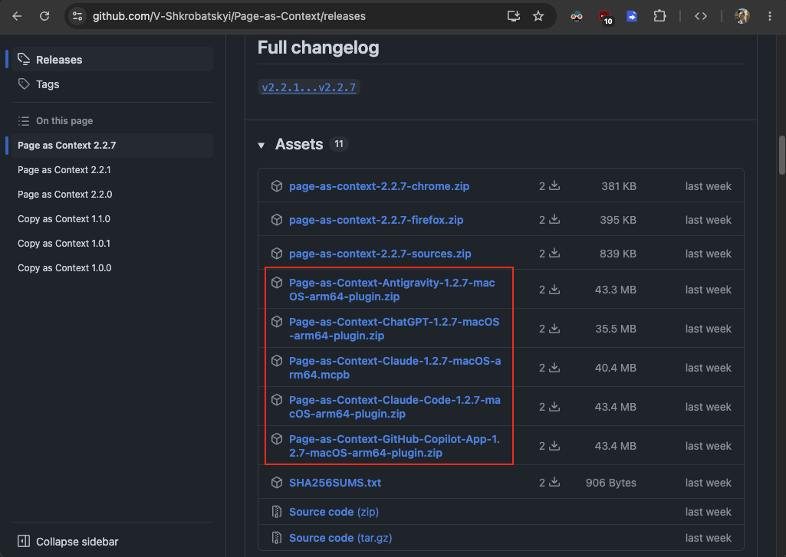
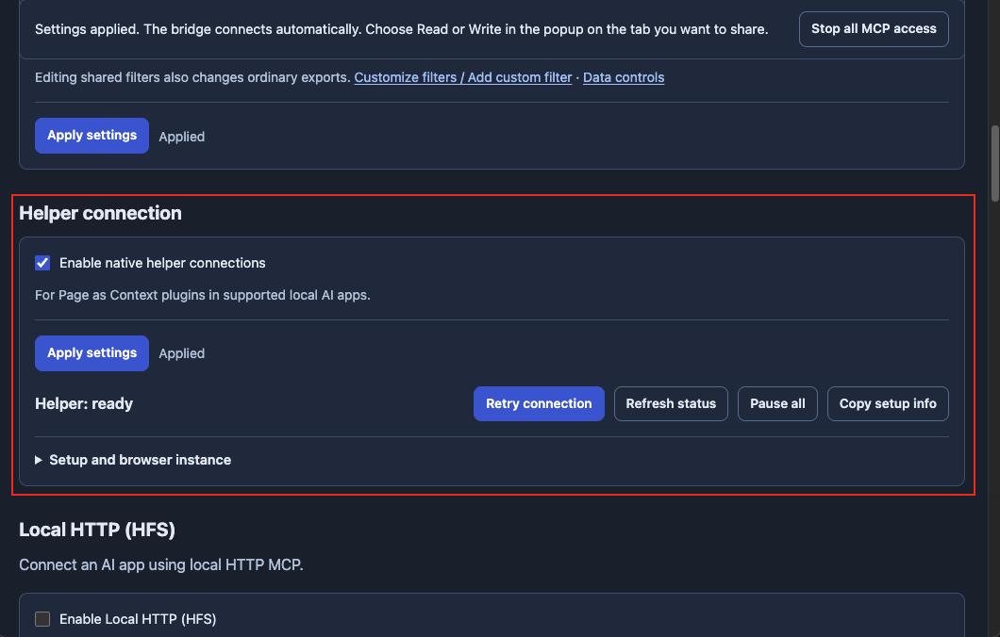
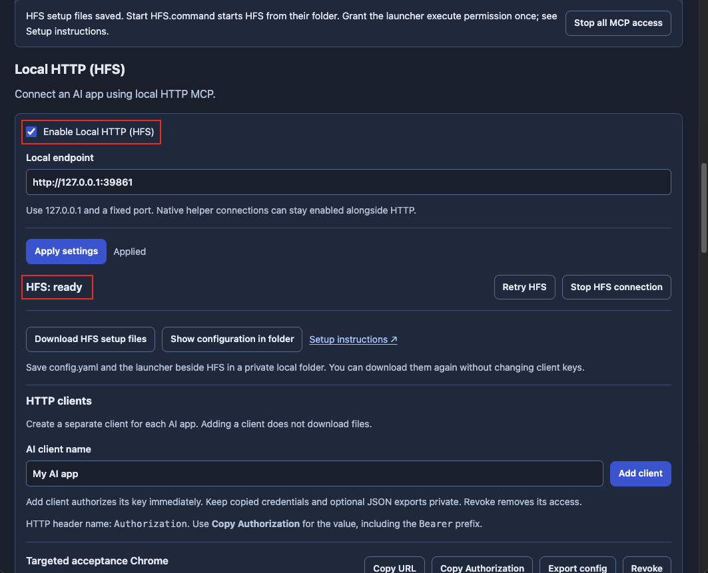

# 5. Choose the right Page as Context setup for your browser and AI app

You do not need an AI integration to use Page as Context. The browser extension alone can capture structured content, apply filters, and prepare text for a chat or local notes.

Direct MCP access is a separate desktop setup. Here is how to choose a route without confusing browser support, package availability, and verified operating systems.

## Start with the browser

| Browser | Main workflow |
| --- | --- |
| Chrome desktop | Capture, selected-element export, preview/edit, copying, saving, and separately configured MCP |
| Firefox desktop | Capture, selected-element export, preview/edit, copying, saving, and separately configured MCP |
| Firefox Android | Whole-page and selected-element capture, preview/edit, and copying; no file saving, desktop shortcuts, or MCP |

Chrome captures an accessibility-tree snapshot and may briefly show a debugger notification. Firefox captures supported HTML/ARIA semantics. Their outputs can differ.

On Firefox desktop, saving requests optional download permission. Capturing frames from other sites is also a separate option that requests HTTP/HTTPS site access. These permissions are unrelated to installing an AI-app plugin.

If you only want to paste context into a chat, stop here: install the extension, configure filters, preview a capture, and copy it.

## Use a native package on macOS Apple Silicon

Ready-to-install packages are available for **ChatGPT Desktop, Claude Desktop, Claude Code, Antigravity, and the GitHub Copilot app**. These packages currently target macOS Apple Silicon.

Choose the package for the exact application and follow its guide. A Claude Desktop MCPB and a plugin directory for another client are not interchangeable. The packages provide their local bridge/runtime; ordinary native setup does not require a separate HFS server or global Node installation.

Download your application's package from the [GitHub release assets](https://github.com/V-Shkrobatskyi/Page-as-Context/releases). The example below shows extension release 2.2.7 with native packages 1.2.7; extension and package versions are separate.

Enable MCP and **Enable native helper connections** in the extension, then **Apply settings**. Use **Copy setup info** to give the assistant the setup instructions, review setup changes, and compare the pairing code. Explicitly share a test tab in Read mode afterward.

## Consider Local HTTP for another compatible client

Local HTTP uses a dedicated HFS installation and requires a **local client supporting Streamable HTTP MCP and bearer-token authentication**. A cloud-hosted client cannot directly reach a server listening on your computer's loopback address. A stdio-only client cannot use this route directly either.

Follow the [HFS guide](../hfs-integration.md) to download the specified HFS version, generate setup files, start the OS launcher, add an HTTP client, and configure its URL and authorization value. Keep configuration files and client credentials private.

Start HFS through the generated launcher so it uses the correct configuration folder. **HFS: ready** confirms the extension's connection to HFS; connecting an AI client and sharing a tab are separate steps. Native helper connections can stay enabled alongside HTTP.

Reads and actions have been tested in Chrome and Firefox on macOS Apple Silicon and Windows 10 x64. Linux setup instructions exist, but Linux HFS startup remains unverified. That distinction matters when choosing a dependable environment.

## Test the connection before using work data

Whichever route you choose, first read a harmless shared tab. Check that unshared tabs are unavailable, then test one permitted action and revoke access.

Native versus HTTP describes the connection. Local versus remote AI describes where the model runs. Your application may send shared context to its model provider, even when the browser connection is entirely local.

Find the current packages and application-specific requirements in the [project repository](../../README.md).

---

[All tutorials](README.md) · Previous: [4. Compression profiles](compression.md) · Next: [6. MCP Read and Write](mcp-read-write.md)
