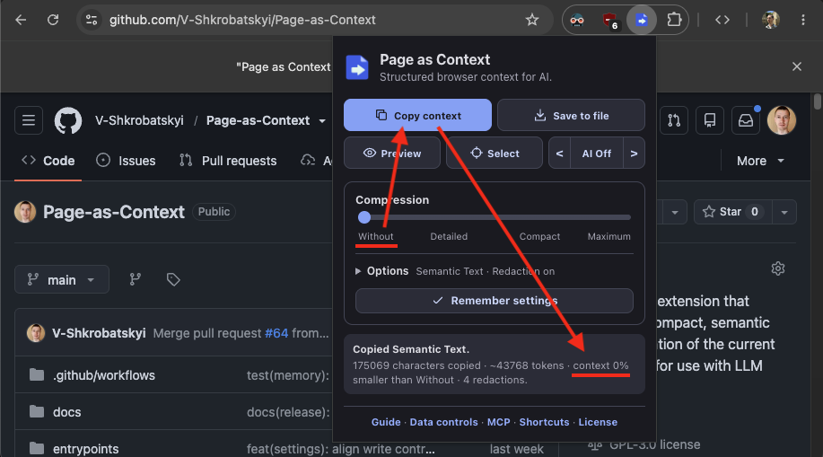
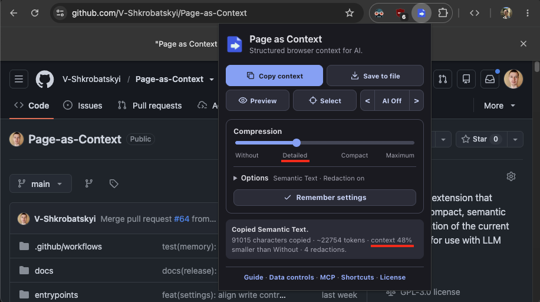
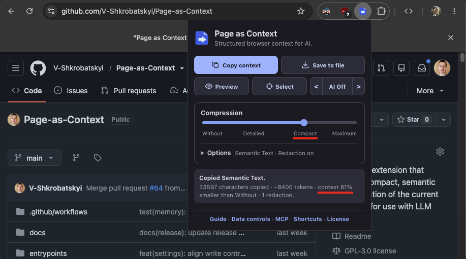
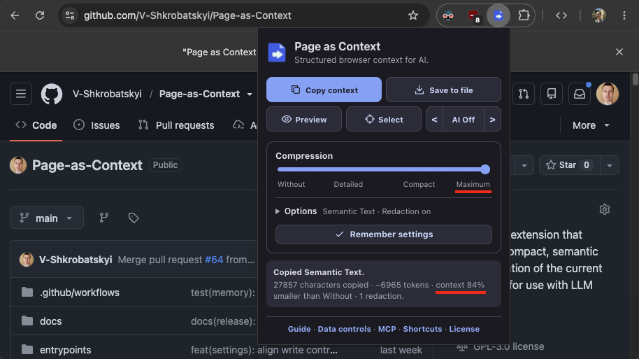

# 4. Choose a compression level for your AI page context

Large pages often repeat labels, navigation, and interface patterns. Page as Context offers four compression profiles to reduce that repetition while keeping useful structure. You can compare their export sizes directly in the popup after copying; opening Preview is optional.

This guide describes version 2.2.8. The screenshots use the public [Page as Context repository](https://github.com/V-Shkrobatskyi/Page-as-Context) as an example. You can repeat the process on another supported page.

## What the four profiles do

| Profile | How to think about it |
| --- | --- |
| **Without** | Keeps every captured semantic node. This is not a complete HTML export. |
| **Detailed** | Removes unnamed wrappers that carry no semantic attributes. |
| **Compact** | Reduces repeated accessibility noise while retaining meaningful controls. This is the default. |
| **Maximum** | Packs profitable repeated text and structures in Compact output, with a legend. Falls back when packing would add overhead. |

Different profiles can produce identical results on some pages. Maximum does not guarantee a smaller export for every page or model tokenizer.

## Compare profiles in the popup

1. Open the page you want to capture. To follow the screenshots, use the repository linked above and capture the whole page.
2. Open the extension popup and expand **Options**. Keep **Semantic Text** selected and **Redact sensitive data** enabled for every capture.
3. Select a compression profile, then click **Copy context**. Keep the popup open until the result appears below the controls.
4. Repeat for the other profiles. Keep the format, privacy settings, page filters, pagination, and expanded sections unchanged.

Changing the slider selects the profile for the next capture. Click **Copy context** after each change to obtain its result. Each copy replaces your clipboard with the latest export.

### Without: establish a baseline

Choose **Without** and copy the page context. The popup shows **0% smaller than Without**, because this profile is the baseline. Its character count gives you a starting point for comparison.

### Detailed: remove unnecessary wrappers

Move the slider to **Detailed** and click **Copy context** again. In this example, the displayed reduction is **48%**. The amount depends on the captured page structure.

### Compact: reduce repeated noise

Select **Compact** and copy again. The screenshot shows **81%** less context than Without. Compact is a useful starting point for everyday capture.

### Maximum: pack repeated content

Select **Maximum** and copy once more. Here, the popup reports **84%** less context than Without and a smaller character count than Compact. Maximum preserves supporting descriptions and hints while packing the context; small or unsuitable pages can still fall back to Compact.

## Read the numbers correctly

These are the values shown in the screenshots:

| Profile | Characters copied | Approximate tokens | Displayed reduction vs Without |
| --- | ---: | ---: | ---: |
| Without | 175,069 | ~43,768 | 0% |
| Detailed | 91,015 | ~22,754 | 48% |
| Compact | 33,597 | ~8,400 | 81% |
| Maximum | 27,857 | ~6,965 | 84% |

The screenshots are separate illustrative captures, not a controlled benchmark. Page content and metadata can change between captures, so your numbers may differ.

Every reduction percentage is relative to Without using the same format and privacy settings, and is rounded to a whole percentage point. The percentage excludes clipboard boundaries, while **characters copied** includes them. Compact and Maximum use different clipboard boundaries, so their counts also include that small difference.

The token estimate is based on character count, not your model's exact tokenizer. Redaction counts can differ because compression removes repeated nodes before filtering; the count is not a measure of how safe it is to share. These figures help compare exports, but do not establish precise API costs, faster capture, or better AI answers.

## Choose a profile for your task

Start with Compact. Try Maximum on repetitive pages, and compare Detailed or Without when you need to inspect what the capture preserved.

To check the content itself, use **Preview** or inspect the copied text. Verify that the labels, values, relationships, and states needed for your question are still clear. If Maximum includes an encoding legend, keep it with the context so the assistant can interpret the representation.

For a smaller task, selecting a relevant block can also reduce the amount you share. See the [selection tutorial](select-edit-export.md) and [export documentation](../capture-and-export.md).

---

[All tutorials](README.md) · Previous: [3. Custom privacy filters](custom-filters.md) · Next: [5. Browsers, AI clients and platforms](browsers-clients-platforms.md)
