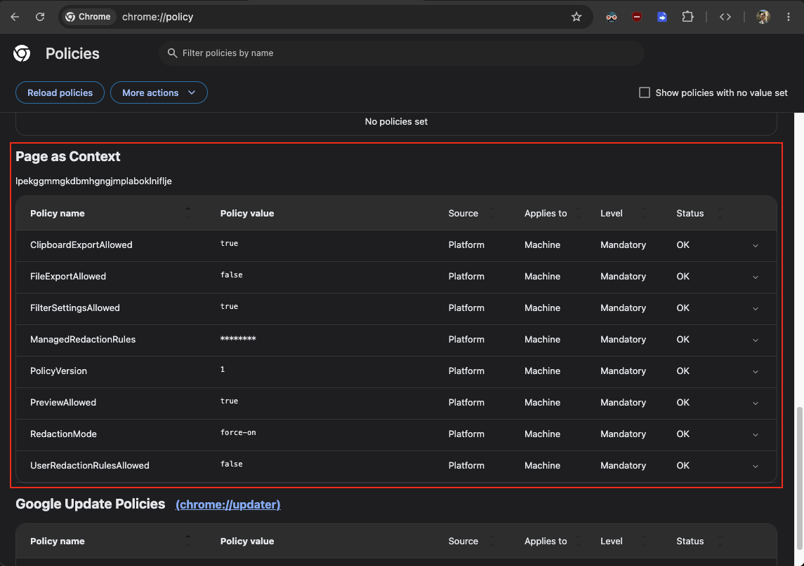
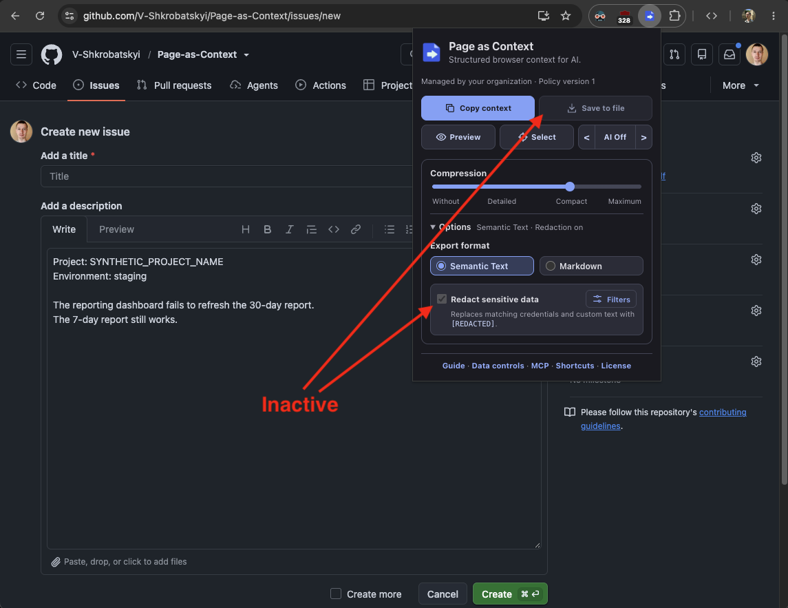
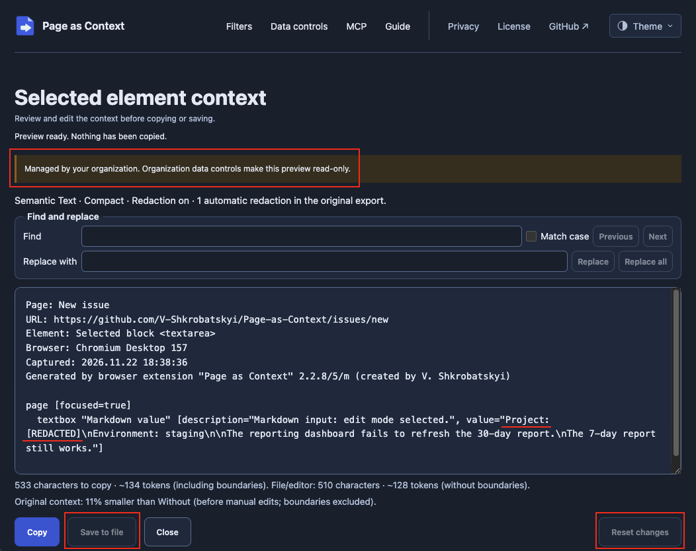
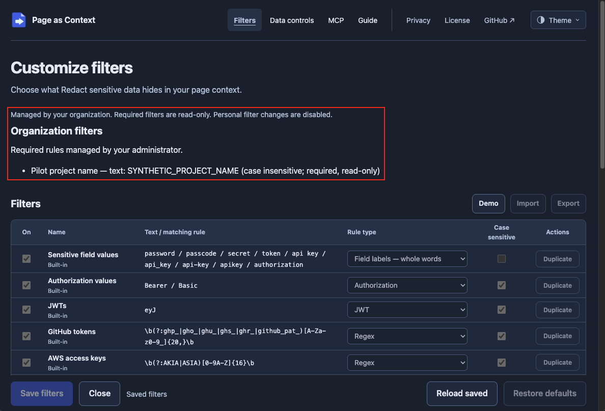

# 7. Set up a small managed-browser policy pilot for Page as Context

Personal privacy settings are useful, but a team may need some rules to apply consistently. For example, an administrator might require redaction, keep a particular internal name out of exports, and disable file saving while allowing clipboard copying.

Page as Context reads organization settings from browser-managed storage. The screenshots show a local Chrome/macOS pilot, not a completed GPO or MDM rollout.

## Define one narrow test

Use a managed test browser or pilot group and a page containing only synthetic data. Record the browser version, operating system, extension version, and actual installed extension ID.

The [tutorial policy values](../enterprise/tutorial-pilot.json) require filtering, hide `SYNTHETIC_PROJECT_NAME`, and disable file exports. Copy and Preview remain available. Filters can be inspected and tested, but personal filter changes are disabled. This JSON needs a browser-specific deployment wrapper; do not import it as a personal filter file.

For a manual Chrome test on macOS, use the [tutorial configuration profile](../enterprise/chrome-macos-tutorial-pilot.mobileconfig): replace `REPLACE_WITH_CHROME_EXTENSION_ID` with the installed extension's ID from `chrome://extensions`, open the file, and approve it in **System Settings → General → Device Management**. The profile applies to that extension on this Mac, not just one Chrome profile.

## Use the template for your environment

The [enterprise deployment guide](../enterprise-deployment.md) provides Chrome and Firefox templates and explains their formats.

Chrome deployment can use Google Admin or platform management. Firefox uses its own enterprise-policy structure and add-on ID. A template for one browser should not be copied unchanged into another.

Verify the installed ID before delivering policies: an unpacked development build can have a different Chrome ID from the store extension. Keep your existing browser policies intact and limit the first change to the pilot scope.

## Check the effective behavior

After delivery, reload policies in `chrome://policy` or inspect `about:policies` in Firefox. Confirm the expected values and check for errors. Chrome masks the custom-rule value in this view; inspect the rule itself in Filters below.



For the example, open a GitHub **New issue** draft and enter this description without publishing it:

```text
Project: SYNTHETIC_PROJECT_NAME
Environment: staging

The reporting dashboard fails to refresh the 30-day report.
The 7-day report still works.
```

Open the popup. Look for **Managed by your organization**, required redaction that cannot be turned off, and unavailable file saving. Copy remains available.



Use **Select** to select the description field, then **Preview & edit**. Check that `Project: [REDACTED]` replaces the project name while the problem details remain. Forced redaction makes Preview read-only: field-aware filtering cannot safely be repeated on arbitrary edits to serialized text. Also verify that **Copy** works.



Open **Filters**. The separate **Organization filters** section above the table shows **Pilot project name** as required and read-only. Personal filter controls are disabled.



Test an already open preview after a policy change as well. It should require newly prepared context rather than silently exporting an older result.

## Roll back and document

Remove or change the pilot policy through the same administrator channel. For the macOS example, remove **Page as Context — tutorial pilot** from Device Management. Confirm the effective browser values and prepare a fresh capture. Do not clear personal settings as a deployment workaround.

Record which environment you tested before expanding the rollout. Extension policies do not prevent ordinary manual copying, another browser, or pasting permitted clipboard content elsewhere. Broader requirements still belong in your organization's browser, device, and data-protection controls.

---

[All tutorials](README.md) · Previous: [6. MCP Read and Write](mcp-read-write.md)
