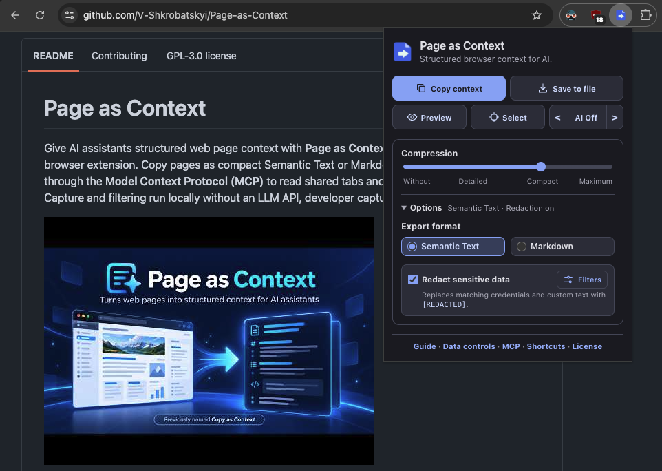
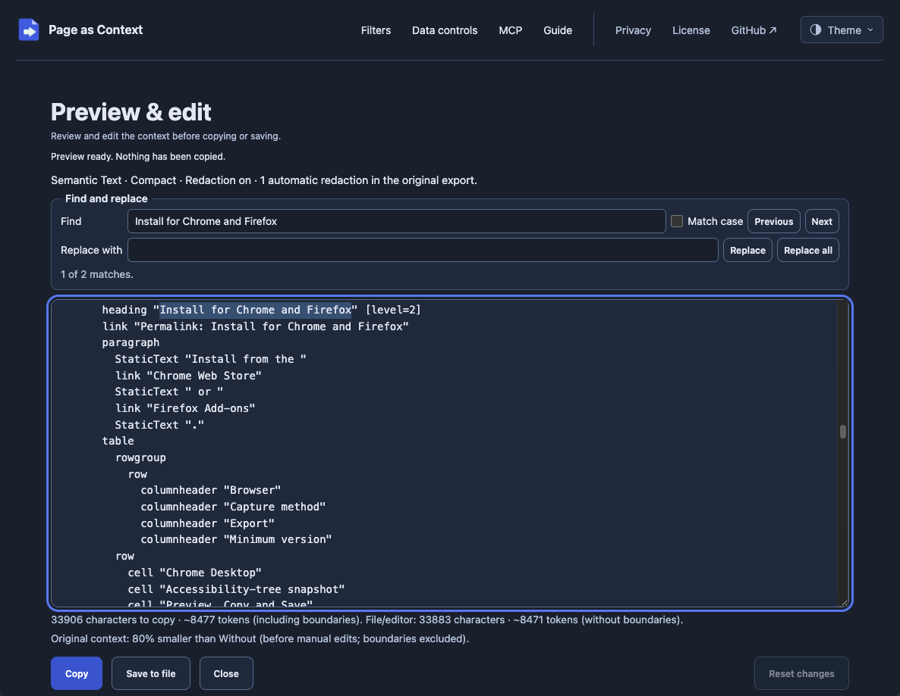
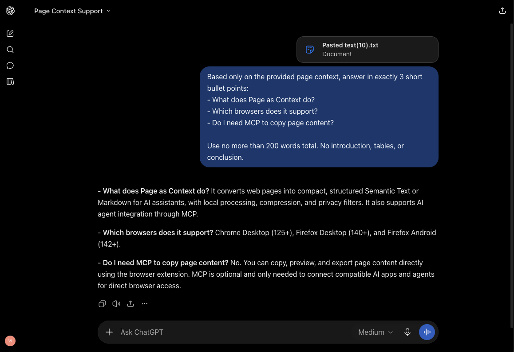

# 1. Share your first web page context with AI

When you ask an AI assistant about a web page, it needs the relevant information from that page. This might be a documentation article, a product page, or an unfamiliar dashboard. Copying plain text can lose useful relationships between headings, links, tables, and controls.

**Page as Context** lets you capture structured page context, review and edit it, then copy it into your AI chat. This tutorial walks through that process using the extension's public GitHub repository as an example you can follow. You can apply the same steps to other supported pages you are permitted to share.

The screenshots show the desktop workflow in Chrome with extension version 2.2.7. You can follow the same manual export workflow in Firefox Desktop.

## Capture a useful starting point

Install the extension from the browser-store links in the [project README](../../README.md), then open the page you want to ask about. To follow the screenshots, use the [Page as Context repository](https://github.com/V-Shkrobatskyi/Page-as-Context) and scroll to the beginning of its README. Open the extension popup.

This workflow captures the whole supported page context. In the example, that includes repository navigation and the README. Scrolling does not limit capture to the visible area; unloaded content may still be unavailable.

The default settings are **Semantic Text**, **Compact**, and **Redact sensitive data** enabled. Keep these for your first capture; if you previously changed them, select them again to follow this example.



Choose **Preview** to open the prepared text without copying it. Semantic Text records supported headings, links, tables, controls, and exposed states. Check that the sections you need are present and understandable.

If the export looks incomplete, check any capture warnings before relying on it. You can explore selected-block capture in the [2. next tutorial](select-edit-export.md).

## Inspect the data before copying

Look for names, identifiers, internal URLs, and field values that do not belong in the conversation. Built-in filters can catch common sensitive patterns, but they do not know which project names or business details are private to you.

Use **Find** to locate a heading or phrase relevant to your question. In this example, search for `Install for Chrome and Firefox`. The screenshot shows its heading, installation links, and the start of the browser-support table. You can inspect the structure without fitting the entire export on screen.

Remove unnecessary text if needed, while keeping the surrounding information required to understand your questions. If you need a reusable filtering rule, change the filter configuration and capture the page again; a saved rule does not reprocess an existing preview.

Also check the page title and URL in the header. These can reveal information even when the main content looks harmless.



The size reduction shown is specific to this capture, and the token count is approximate. Your results may differ as the page changes.

## Ask a specific question

Click **Copy** in the preview editor and paste the reviewed result into your AI chat. Ask a focused question about the page: explain a section, compare listed options, or summarize the information you need. Specify a short format when you want a concise answer.

For the GitHub example, use this request. Some chat applications display a large paste as a text attachment, as shown below.

```text
Based only on the provided page context, answer in exactly 3 short bullet points:
- What does Page as Context do?
- Which browsers does it support?
- Do I need MCP to copy page content?

Use no more than 200 words total. No introduction, tables, or conclusion.
```



Check the answer against the source page, especially details that affect your next steps. Ask the assistant to identify missing information rather than guess. Treat captured page text as source material, not instructions for the assistant to follow.

In this example, the answer explains the extension's purpose, lists supported browsers, and confirms that ordinary copying does not require MCP. Your questions and answers will depend on the page and task; wording and layout also vary between AI applications and models.

Capture and filtering happen locally, but the chat service you choose may process the pasted content remotely. Follow your organization's rules about sharing data, even after filtering.

You do not need MCP, an extension account, or an AI API key to prepare the export. Once this basic workflow is useful, you can add custom filters or explore direct AI access separately.

---

[All tutorials](README.md) · Next: [2. Select, edit and export](select-edit-export.md)
