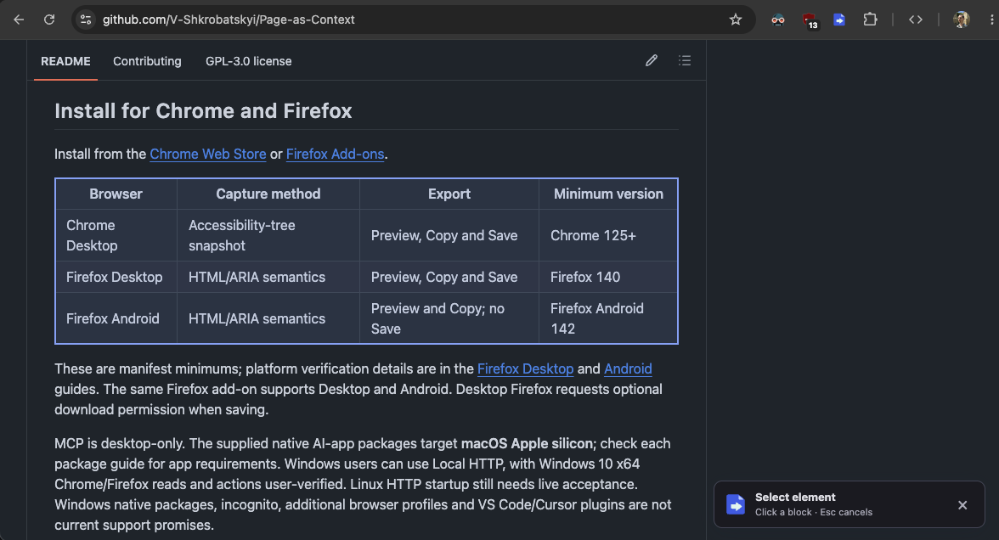
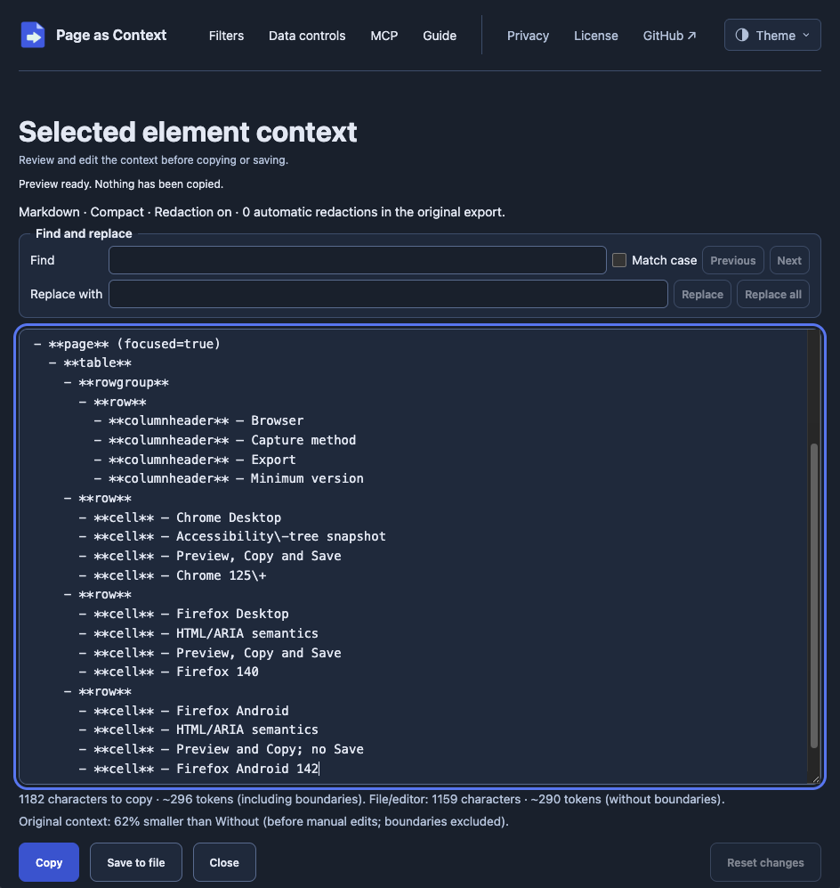
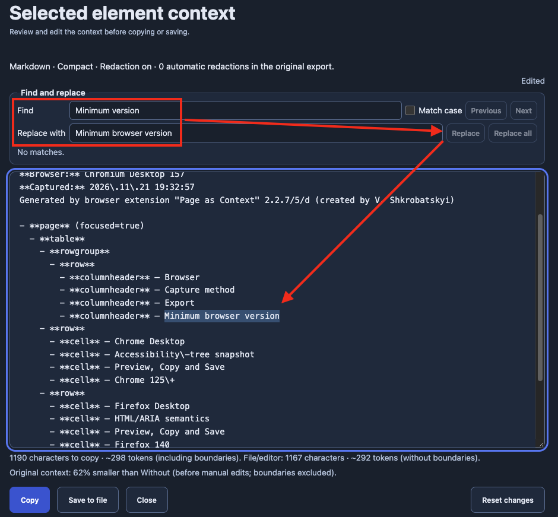
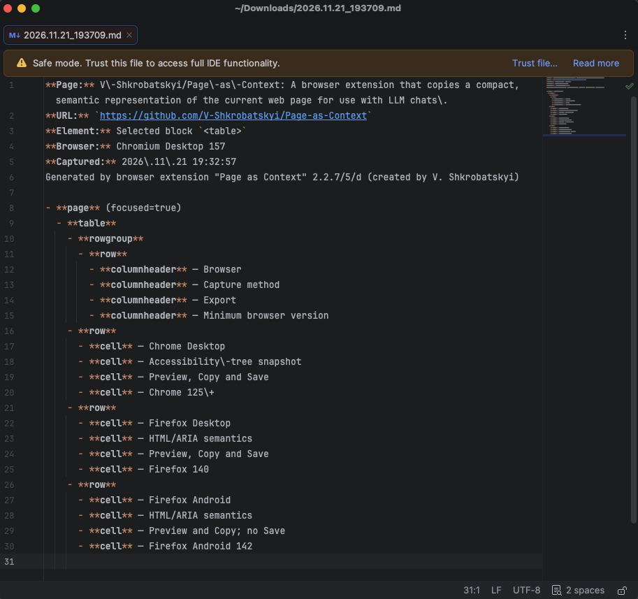

# 2. Choose, edit, and export the page context you actually need

An AI assistant does not always need the whole page. If your question concerns one settings panel, exporting navigation menus, account details, and unrelated tables can make the context harder to review.

Page as Context lets you capture a selected page element, review its structure, and edit the result before copying or saving. This guide describes version 2.2.8; the screenshots show the same workflow in Chrome with version 2.2.7.

## Start from your question

Choose a block that contains the information your question needs, such as a table, an article section, or a settings panel. Keep its headings and labels when they are needed to interpret the content.

To follow this example, open the [Page as Context repository](https://github.com/V-Shkrobatskyi/Page-as-Context) and find the browser-support table under **Install for Chrome and Firefox**. We will export that table, then clarify one of its column headings.

## Choose a format before capture

In the extension popup, choose **Markdown**, keep **Compact**, and leave **Redact sensitive data** enabled. Compact and filtering are enabled by default; change them back if you previously selected other settings.

Markdown expresses the captured structure with formatting such as nested lists and bold role labels. In this example, the table becomes structured rows and cells rather than a conventional Markdown table.

You can also use **Semantic Text** for supported roles, controls, and exposed states, as in the [first tutorial](first-page-context.md). Choose your format before preparing the capture.

## Select the complete block

Click **Select** in the popup to start the element picker. Move over the table until the outline includes all column headings and all three browser rows, then click to select it. Selecting one cell would leave out information needed to compare browsers.

Once selected, use the picker's **Preview** action to open that block's context. For other pages, choose a container that includes the relevant content and its labels. Check any capture warnings before relying on the result.

## Review and edit

The editor opens as **Selected element context**. Check that it contains the table's headings and rows, without the rest of the README or GitHub navigation. Export metadata, such as the page URL and selected-element description, can still be included.

To make the column heading more explicit:

1. Enter `Minimum version` in **Find**.
2. Enter `Minimum browser version` in **Replace with**.
3. Click **Replace** and check the updated heading in the text.

After the replacement, **No matches** means the original phrase is no longer present. The editor shows **Edited**, and **Reset changes** becomes available. These edits affect the export draft; the source website stays unchanged.

You can also remove irrelevant text manually. Keep enough labels and surrounding structure for the remaining content to make sense.

Format, compression, and filtering are fixed for that preview. To change them, return to the source page, adjust the settings, and prepare a new capture. Saved filters do not automatically update an already open draft.

## Copy or save

Click **Copy** to send the reviewed text to your clipboard, or **Save to file** to create a local UTF-8 file. With Markdown selected, the saved file has a `.md` extension. Open it in a text editor and confirm that `Minimum browser version` is present.

In Firefox, saving requests optional download permission; keep the saving tab open until the operation finishes.

Treat the preview as temporary: copy or save useful edits before closing or reloading it. It is not a persistent document editor.

Firefox Android also supports element selection, preview, and copying. File saving remains Desktop-only. Organization policies may also restrict editing or export.

For more detail, see the [capture and export guide](../capture-and-export.md).

---

[All tutorials](README.md) · Previous: [1. Your first web page context](first-page-context.md) · Next: [3. Custom privacy filters](custom-filters.md)
